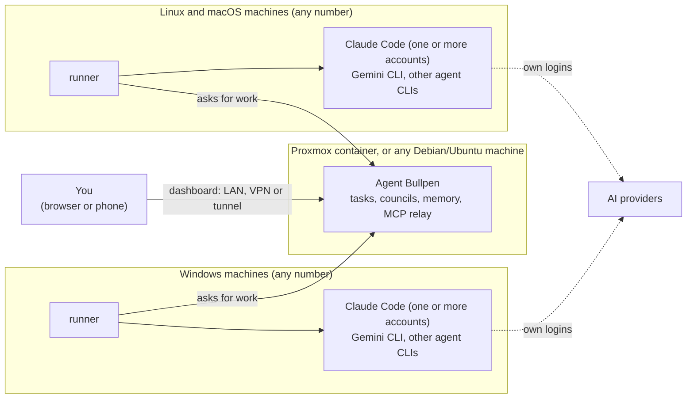

<div align="center">

# Agent Bullpen

**One self-hosted dashboard for the AI coding agents on all your machines.**

[](LICENSE)
[](https://github.com/rob-paprocki/agent-bullpen/actions/workflows/ci.yml)
[](#requirements-and-sizing)
[](#requirements-and-sizing)
[](docs/04-proxmox-hub.md)

[Quick start](#quick-start) · [Features](#features) · [Guides](#guides) · [Security](#security-in-brief) ·
[Terms and accounts](#terms-and-accounts) · [Report a problem](https://github.com/rob-paprocki/agent-bullpen/issues)

</div>

If you use Claude Code (with one or more Claude accounts), Gemini CLI or other coding agents on several Linux,
macOS and Windows computers, Agent Bullpen puts them all on one web page. It is for people who like to host
their own tools, in a home lab or on a small server. A small team that trusts each other can share one hub.
Each person's agents run on that person's own accounts and machines. The dashboard has one password for now,
so everyone who can log in can use every machine.

The **hub** is a small web app (Python, FastAPI and SQLite) in a Proxmox container or on any Debian or Ubuntu
machine. The **runner**, one Python file with no dependencies, goes on each machine and runs the agents'
official command-line programs.

## Highlights

- Send a task to any agent on any machine, from your browser or your phone.
- Choose per task what the agent may do, from read only to running commands. A Claude agent can ask you
  before each command, and you press **Allow** or **Deny**.
- Have several agents debate a question or review each other's code. Every agent gets the same notes and MCP servers.
- Add Linux, macOS and Windows machines with one pasted command. They need no open ports.
- Each agent is the provider's own program, signed in by its owner ([terms](#terms-and-accounts)).

## Quick start

You need a Proxmox VE 8 or 9 host for the hub (or any Debian 12+ or Ubuntu 24.04+ machine), one or more Linux,
macOS or Windows machines for the agents, and your own Claude subscription or API key.

1. **Install the hub.** On a Proxmox VE host (amd64), open the node's **Shell** and paste:

   ```bash
   bash -c "$(curl -fsSL https://raw.githubusercontent.com/rob-paprocki/agent-bullpen/main/ct/bullpen.sh)"
   ```

   Choose **Default Install**. It creates a small Debian container, checks the newest release against the
   release's checksums and installs it. Without Proxmox, any Debian 12 or Ubuntu 24.04 (or newer) machine
   works too. Download a release, check it against its checksums and run `scripts/linux/install-hub.sh`
   ([guide 4, "Any Debian or Ubuntu machine"](docs/04-proxmox-hub.md#any-debian-or-ubuntu-machine)).
2. **Open the dashboard** at the address the installer prints, for example `http://192.168.100.20:8080`, and
   log in with the password it shows.
3. **Add a machine.** On **Overview**, click **Add a machine**. Copy the command for Linux and macOS, or the one
   for Windows, and paste it into a terminal on that machine, as your normal user. The code in it works once,
   for one hour. Repeat for each machine.
4. **Sign in to your agents.** The setup asks which agents to offer and signs each Claude account in through
   your browser. For Gemini CLI it asks for an API key.
5. **Send a first task** to the `selftest` agent, which costs nothing. Then try a real agent.

## Features

| Feature | What it does |
|---|---|
| [Tasks](docs/08-daily-use.md#new-task-one-prompt-one-agent) | Pick a machine, agent, project folder and model, write a prompt, watch the live log, and follow up in the same conversation. |
| [Autonomy per task](docs/02-architecture.md#autonomy-levels) | Read only (the default), edit files, edit files and ask you before each command, or run commands too. |
| [Live sessions and approvals](docs/08-daily-use.md#a-jobs-page) | Type to a Claude agent while it works. Or let it ask before each command: you see the whole command, then press **Allow** or **Deny**, from a phone too. |
| [Remote Control](docs/08-daily-use.md#live-interactive-sessions-remote-control) | Start Anthropic's own Remote Control for a Claude agent, then drive it from claude.ai/code or the Claude app. It stops by itself after 8 hours. |
| [Notifications](docs/08-daily-use.md#notifications-on-your-phone) | A message through ntfy or any webhook when a task finishes, fails or waits for you. The message never contains the prompt or the answer. |
| [Councils](docs/08-daily-use.md#council-agents-working-together-and-against-each-other) | *Debate*: agents answer, critique each other's answers without knowing who wrote what, and a judge rules. *Build + review*: one agent makes a change, others look for bugs in the diff, and the builder fixes the ones that hold up. |
| [Subtasks](docs/08-daily-use.md#letting-an-agent-hand-out-subtasks) | A task's agent hands work to your other machines, within the machines, projects and accounts you allow. Each one is a job you can see and cancel. |
| Any number of machines | Linux and macOS ([guide 5](docs/05-linux-and-macos-machines.md)), Windows 10 and 11 ([guide 6](docs/06-windows-machines.md)). Tags such as `gpu` let you send work to "any machine tagged gpu". |
| Any number of accounts | Several Claude logins per machine, Gemini CLI with an API key, and other programs as "text" agents ([guide 11](docs/11-adding-agents.md)). |
| [Shared memory](docs/10-shared-memory-and-mcp.md#shared-memory) | `/remember` in any agent saves a note every agent can find. Pinned notes go into every agent's own memory file. |
| [One MCP list](docs/10-shared-memory-and-mcp.md#the-central-mcp-list) | Add an MCP server once on the hub, and every agent gets it. Keys and OAuth sign-ins stay on the hub. |
| [Plan limits](docs/08-daily-use.md#usage) | Each Claude account's 5-hour and weekly limits, and the tokens each job used. For planning only: the hub never switches accounts. |
| [Platform credits](docs/08-daily-use.md#platform-credits) | The Usage page estimates what is left of the monthly API credits some Claude plans include. If you turn it on, council steps, subtasks and a task stopped by a usage limit can run on a machine's API-key "credits agent" ([terms](#terms-and-accounts)). |
| [Machine management](docs/08-daily-use.md#a-machines-own-page) | Clone and pull projects, and update every runner, from the dashboard. |
| [API gateway](docs/07-api-gateway.md) (optional) | LiteLLM and the LibreChat chat app for your Anthropic Console organizations, with each one's spend. |

## What it is not

- Not a hosted service. You run it on your own hardware, and it sends nothing to this project (no telemetry).
- Not a way to share a subscription. See [Terms and accounts](#terms-and-accounts).
- Not a chat app. A task runs to completion, or stays open for a few messages while you watch. For long
  back-and-forth sessions, use Anthropic's own Remote Control, which the dashboard can start for you
  ([guide 8](docs/08-daily-use.md#live-interactive-sessions-remote-control)).
- Not a sandbox. An agent you allow to run commands runs them on your machine, as you.

## How it fits together

This is the short version of [guide 2](docs/02-architecture.md). The hub never connects *to* your machines.
Each runner asks the hub for work, so the machines need no open ports. The agents talk to their providers
directly, with the logins on that machine. The hub does no AI work itself.



## Requirements and sizing

| Part | What it needs |
|---|---|
| Hub | Proxmox VE 8 or 9 on amd64 for the one-line installer, or Debian 12+ / Ubuntu 24.04+ with Python 3.11 or newer. Internet access to GitHub and the Python package index while it installs. |
| Each machine | Linux (written for Debian, Ubuntu and Kali first; Fedora, Arch and openSUSE are best effort), macOS, or Windows 10 or 11 with winget. The setup installs Git, Python 3.9+ and, for Gemini CLI, Node.js 20+. |
| Accounts | For Claude Code: a Claude subscription or an Anthropic API key. For Gemini CLI: a paid Gemini API key ([guide 1](docs/01-accounts-and-rules.md) explains why). Each person uses their own. |
| Network | Each machine must reach the hub's port (8080 by default). To use the dashboard away from home, you need a VPN or a tunnel ([guide 3](docs/03-cloudflare.md)). |

The memory figures below are rough. Watch your own with `free -m` or Task Manager
([guide 2](docs/02-architecture.md#sizing)).

| Where | Memory |
|---|---|
| The hub | about 100 MB (measured at 76 to 97 MB with 25 and with 200 simulated machines) |
| The hub's container | 1 CPU core, 1024 MB, 6 GB disk by default; 2 cores, 2048 MB, 10 GB disk for dozens of machines or several MCP servers through the hub |
| Each machine | about 30 MB for the idle runner, plus about 300 to 700 MB per running job, so set "jobs at once" to fit |
| API gateway (optional) | a Linux machine with Docker that is on most of the time: about 1 to 2 GB for LiteLLM, about 3 to 4 GB with LibreChat |

## Guides

Follow them in the order of the Step column. The scripts ask before they change anything. Once the hub and one
machine are set up, the dashboard works, and you can add the rest whenever you like.

| Step | Guide | What it covers | Time |
|---|---|---|---|
| 1 | [1 · Accounts and the rules](docs/01-accounts-and-rules.md) | What the providers allow, and what each account pays for | 10 min read |
| 2 | [2 · How it fits together](docs/02-architecture.md) | Design, memory, security | 10 min read |
| 3 | [4 · The hub](docs/04-proxmox-hub.md) | The hub on Proxmox, or on any Debian or Ubuntu machine | 10 min |
| 4 | [5 · Linux and macOS machines](docs/05-linux-and-macos-machines.md) | A runner and your agents, repeated on each machine | 15 min each |
| 5 | [6 · Windows machines](docs/06-windows-machines.md) | The same on Windows 10 and 11 | 15 min each |
| 6 | [3 · Reaching the hub from outside](docs/03-cloudflare.md) (optional) | A VPN, your own TLS, or Cloudflare | 20 min |
| 7 | [8 · Using it day to day](docs/08-daily-use.md) | Tasks, councils, approvals, Remote Control, usage, notifications | – |
| 8 | [10 · Shared memory and MCP](docs/10-shared-memory-and-mcp.md) | `/remember` and one MCP list for every agent | 15 min |
| 9 | [7 · API gateway and chat app](docs/07-api-gateway.md) (optional) | LiteLLM and LibreChat for your Console organizations | 20 min |
| 10 | [11 · Adding other agent CLIs](docs/11-adding-agents.md) | Any other CLI as a "text" agent | – |
| – | [9 · Troubleshooting](docs/09-troubleshooting.md) | Where the logs are, and fixes by symptom | – |

## Security in brief

- **Whoever can log in to the dashboard controls every machine.** They can run commands on your machines (a
  "Full auto" task), start programs on all of them (an MCP server of the "local program" kind), and push a
  runner update. Use a long password. Keep the dashboard on your network or a VPN, or behind a login wall such
  as Cloudflare Access. Never open its port on your router.
- **Each machine has its own runner token.** The hub keeps only its fingerprint. **Forget** on the dashboard revokes it.
- **Subtasks are off unless you allow them**, per task, and they only read unless you raise the hub's limit.
  Tags and account labels a machine reports count only after you accept them.
- **The hub never sees the agents' logins.** They stay on each machine. Keys and OAuth sign-ins of MCP servers
  that go through the hub stay on the hub.
- **Plain HTTP on your network by default.** Anyone who can watch your network traffic can read the dashboard
  password, the tokens and the prompts. That's fine on a home network you trust. Otherwise use a VPN or TLS
  ([guide 3](docs/03-cloudflare.md)).
- **No telemetry.** The installers download only from GitHub, your systems' package mirrors and the official
  source of each tool you choose (Claude Code from claude.ai, Gemini CLI from npm, Node.js from NodeSource or
  Homebrew, cloudflared from Cloudflare's package repository). The hub talks only to the services you set up.

[SECURITY.md](SECURITY.md) has the details, and says how to report a security problem privately (not in an issue).

## Terms and accounts

Agent Bullpen starts the providers' own, unmodified programs (Claude Code, Gemini CLI) on your machines, signed
in with your own accounts. The hub never sees or stores those logins. [Guide 1](docs/01-accounts-and-rules.md)
quotes the providers' rules in full. They change often, so check the providers' pages for your own case.

- **Each person signs in to their own accounts, on their own machines.** Don't use Agent Bullpen to give other
  people access to your subscription, and don't run it for other people on your login.
- **No account pool, and no switching.** The hub never shares one person's subscription with others. It has no
  "switch to another account when this one hits its limit" feature, on purpose. Give each account its own
  purpose (for example `claude-work` for your employer's projects) and pick the account per job.
- **At a limit, wait for the reset. The only fallback is API billing.** When an account reaches a limit, its
  jobs fail with a message that says when it resets. Platform credits are off by default. If you turn them on,
  council steps and subtasks run on that machine's API-key "credits agent" while its credits last. A task
  stopped by a usage limit is run again there once. The hub refuses a credits agent that signs in with a
  subscription. The only automatic move is from a subscription agent to that machine's credits agent, and
  back when the credits run short. The hub decides by the credits' estimated balance, never by a
  subscription's remaining usage. Work never moves from one subscription account to another
  ([guide 1](docs/01-accounts-and-rules.md#platform-credits-the-api-credit-in-your-plan)).
- **Anthropic's rules for Claude Code.** The
  [legal and compliance page](https://code.claude.com/docs/en/legal-and-compliance) says the subscription login
  is "designed to support ordinary use of Claude Code and other native Anthropic applications", and that third
  parties may not "route requests through Free, Pro, Max, or Ultra plan credentials on behalf of their users".
  It also says this does not prevent "an end user from signing in to the unmodified Claude Code binary with
  their own Claude subscription", which is what Agent Bullpen does.
- **Councils use your limits fast.** The same page says "Advertised usage limits … assume ordinary, individual
  usage of Claude Code and the Agent SDK." A three-way debate with a judge is seven agent runs; with a revise
  round it is ten.
- **Gemini runs on an API key.** Google says Gemini CLI stays available through paid API keys
  ([announcement](https://developers.googleblog.com/an-important-update-transitioning-gemini-cli-to-antigravity-cli)),
  and that wrapping Antigravity inside other apps isn't supported on consumer plans
  ([FAQ](https://antigravity.google/docs/faq/)). So the hub runs Gemini CLI with a key. It only adds shared
  notes and MCP servers to Antigravity, and never drives it.

## Status and contributing

The hub, the runner and the councils are tested end to end with the built-in fake agent on every change
(`python3 tests/smoke_test.py`, in [CI](.github/workflows/ci.yml)). The Proxmox installer is tested with
stand-in commands for Proxmox, not yet on a real Proxmox VE host. The installers and setup scripts have not
yet been run on every system they support, so read what each step prints. What may come next is in the
[roadmap](ROADMAP.md); nothing there is promised or dated.

If something goes wrong, [Troubleshooting](docs/09-troubleshooting.md) says where the logs are. If that
doesn't help, [open an issue](https://github.com/rob-paprocki/agent-bullpen/issues) with the version, what you
did and the log lines. Remove passwords, tokens, API keys and enrollment codes first.

Help is welcome. A report from real hardware helps most, even when everything worked: a Proxmox VE host, a
Mac, a Fedora or Arch machine, or Windows 10. Small fixes to the guides need no issue. For another agent CLI,
open an issue first. [CONTRIBUTING.md](CONTRIBUTING.md) has the ground rules, the checks and how to set up a
development copy. Everyone taking part follows the [code of conduct](CODE_OF_CONDUCT.md).

<details>
<summary><b>What's in this repository</b></summary>

```
ct/, install/, misc/  the Proxmox one-line installer (runs on the Proxmox host and in the container)
hub/                  the hub: Python (FastAPI) + SQLite + a plain-JavaScript web page (static/)
  app.py, db.py       web routes (the dashboard API and the runner API), and storage
  council.py          the multi-agent workflows (debate, build + review) and their prompts
  enroll/             one-time codes and the one-line setup commands for new machines
  memory.py, mcp_server.py   shared notes (pinned + searchable), and the hub's own MCP endpoint for them
  registry.py, mcp_proxy.py  the central MCP list, and the relay that serves each server at /mcp/s/<name>
  upstream_oauth.py   the one-time OAuth sign-in for those servers, and token renewal
  job_mcp.py          the job tools at /mcp/job: what a running job may ask the hub, with its own job token
  usage.py            API spend from Anthropic's Admin API, plus links to each provider's usage pages
  limits.py           plan limits and tokens per job as the Usage page shows them (display only)
  credits.py          platform credits: the estimate, and which background jobs may run on a credits agent
  common.py           small helpers the other hub modules share
runner/               runner.py (on every machine; standard-library Python only), selftest_agent.py (fake agent)
scripts/
  proxmox/            create-hub-lxc.sh, upgrade-hub-lxc.sh (the installer, from a local copy)
  linux/              install-hub.sh, setup-workstation.sh (Linux and macOS), setup-api-gateway.sh
  windows/            Setup-Workstation.ps1
  release/            bump-version.py, next-version.py, release-notes.py, set-repo.sh
stack/                Docker files and the settings generator for LiteLLM and LibreChat
agent-kit/            add-ons every machine installs: /remember, /recall, "second opinion"
docs/                 the step-by-step guides
tests/                the end-to-end test, the installer tests, the release tests and tests/check_repo.py
```

</details>

## Not affiliated

Agent Bullpen is an independent project. It is not affiliated with, endorsed by or sponsored by Anthropic,
Google, OpenAI, Proxmox Server Solutions GmbH or the community-scripts project. Claude and Claude Code are
trademarks of Anthropic. Gemini and Antigravity are trademarks of Google. Proxmox is a registered trademark of
Proxmox Server Solutions GmbH. The names are used only to say what Agent Bullpen works with. The Proxmox
installer follows the look of the community-scripts installers, but it is separate code.

## Licence

MIT: see [LICENSE](LICENSE). The pieces Agent Bullpen installs are open source too: FastAPI, Uvicorn, the MCP
Python SDK, PyJWT, LiteLLM's core, LibreChat, Postgres and Gemini CLI. The exceptions are some of the agents
themselves (Claude Code, Antigravity) and the hosted services, which have their own terms.
